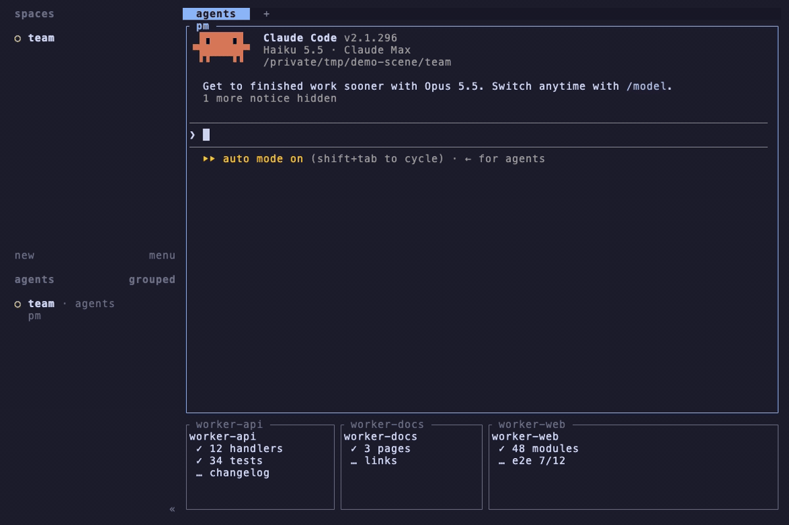
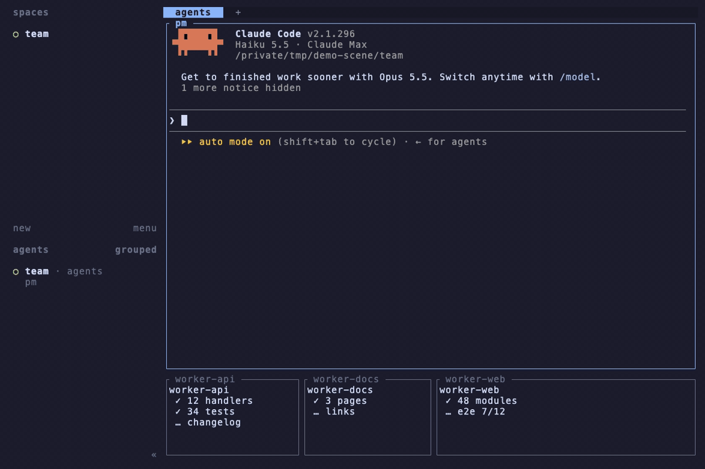

# herdr-holdback


[English](../README.md) | [简体中文](./zh-sc.md) | [繁體中文](./zh-tc.md) | [Español](./es.md) | [Português](./pt.md) | [Русский](./ru.md) | [日本語](./jp.md) | [Français](./fr.md) | [Deutsch](./de.md) | [Tiếng Việt](./vi.md) | [한국어](./ko.md) | [ไทย](./th.md) | [Italiano](./it.md)

<p align="center">
  <a href="#cài-đặt">Cài đặt</a> · <a href="#giới-hạn">Giới hạn</a>
</p>

> Bạn đã bao giờ bị agent khác GANK giữa chừng khi đang gõ prompt trong workflow đa agent của Herdr chưa?

Bạn chạy một agent PM và vài worker trong Herdr. Bạn đang viết dở prompt cho PM thì một worker báo cáo, và tin nhắn bị gõ thẳng vào cùng ô nhập. Chỉ một cú Enter, cả hai bay đi thành một yêu cầu lộn xộn.

**Trước**



Holdback bắt chúng xếp hàng chờ lượt. Tin nhắn dành cho pane bạn đang xem xếp hàng trong một thanh phía trên nó, và được đưa vào khi bạn xong việc.

**Sau**



- **Ô nhập vẫn là của bạn** — không có gì bị gõ vào khi bạn đang gõ; tin nhắn chỉ được giao khi ô nhập trống.
- **Thấy ai đang chờ** — thanh hiện số tin nhắn đang xếp hàng, người gửi và vài từ đầu của từng tin.
- **Nhận khi bạn muốn** — nhấp vào thanh hoặc bấm phím để xem danh sách; tin nhắn được đưa vào theo đúng thứ tự đến.
- **Tin nhắn có chữ ký** — bắt đầu tin nhắn bằng `tên 💬 ` và thanh sẽ hiện tin đó đến từ agent nào.
- **Hoặc cứ làm việc tiếp** — chuyển sang pane khác và hàng đợi sẽ được giao theo thứ tự.
- **Các pane khác không bị đụng tới** — tin nhắn gửi cho pane bạn không xem được giao ngay.

## Cài đặt

Cần Herdr 0.9.3 trở lên và Node 18 trở lên.

```sh
herdr plugin install navishachiku/herdr-holdback
```

Gán một phím trong `~/.config/herdr/config.toml` rồi tải lại bằng `prefix+shift+r`:

```toml
[[keys.command]]
key = "alt+i"
type = "plugin_action"
command = "herdr-holdback.open"
description = "open the holdback list"

# Notifications are off by default; the queue notice needs this.
[ui.toast]
delivery = "herdr"
```

## Giới hạn

- Nếu một lần giao thất bại, việc đẩy hàng đợi dừng lại và phần còn lại vẫn nằm trong hàng đợi; không có gì bị mất.
- Nếu tiêu điểm rời hẳn khỏi Herdr (bạn chuyển sang ứng dụng khác), sẽ không có gì được giao cho đến khi tiêu điểm chuyển sang một pane khác.

<details>
<summary>Nâng cao: gửi tin nhắn, cơ chế bên trong, cấu hình, kiểm thử</summary>

### Gửi một tin nhắn

Mọi thứ muốn xếp tin nhắn của mình vào hàng đợi khi bạn đang xem đều đi qua `src/send.mjs`:

```sh
node ~/Project/herdr-holdback/src/send.mjs --to w1:p2 "Task-58/TL 💬 gate 1 reached"
```

Phần văn bản trước ` 💬 ` được dùng làm người gửi trong thông báo; truyền `--from` để chỉ định rõ. Đầu ra là một dòng JSON: `{"ok":true,"queued":true,"count":2}` khi tin bị giữ lại, `"queued":false` khi tin được giao ngay. Tin nhắn gửi tới pane có agent đi qua `herdr agent prompt`, tới terminal thường đi qua `herdr pane run`.

Repo này chỉ cung cấp hàng đợi và điểm vào. Việc khiến các agent của bạn gọi nó thay vì `herdr agent prompt` là do lớp chặn gửi tin của riêng bạn đảm nhiệm.

### Cách hoạt động

| Thành phần | Vai trò |
| --- | --- |
| `src/daemon.mjs` | Hàng đợi chạy nền liên tục. Quyết định xếp hàng hay giao ngay, đẩy hàng đợi khi tiêu điểm rời đi, giữ thanh phía trên pane. Mỗi lần xử lý một yêu cầu. |
| `src/on-focus.mjs` | Hook `pane.focused`. Sự kiện của Herdr không cho biết pane nào vừa bị rời đi, nên daemon tự nhớ tiêu điểm trước đó và khởi tạo nó bằng `herdr pane list` lúc khởi động. |
| `src/open.mjs`, `src/list.mjs` | Hành động của phím và danh sách popup. |
| `src/send.mjs` | Điểm vào cho bên gửi. |

Khi tin nhắn cũ nhất đã chờ 5 phút và ô nhập đang trống, cả hàng đợi được giao theo thứ tự; daemon kiểm tra điều này mỗi `check_interval_seconds` (xem Cấu hình).

Hàng đợi nằm trong một tệp, nên daemon khởi động lại sẽ tiếp tục từ chỗ nó dừng. Trạng thái nằm ở `~/.local/state/herdr/plugins/herdr-holdback/` (`queue.json`).

### Cấu hình

Lần chạy đầu tiên sẽ ghi `config.toml` vào thư mục cấu hình của plugin (`herdr plugin config-dir herdr-holdback`):

```toml
check_interval_seconds = 30
```

Tần suất daemon kiểm tra xem pane bạn đang xem có tin nhắn nào đã chờ 5 phút hay không. Mặc định 30 giây; khởi động lại daemon để áp dụng thay đổi. Bản thân khoảng chờ 5 phút không cấu hình được.

### Kiểm thử

```sh
npm test
```

Chạy daemon và các điểm vào thật với một tệp thực thi `herdr` giả. Các bài kiểm thử popup cần `python3` để có pseudo-terminal.

</details>

## Giấy phép

MIT
